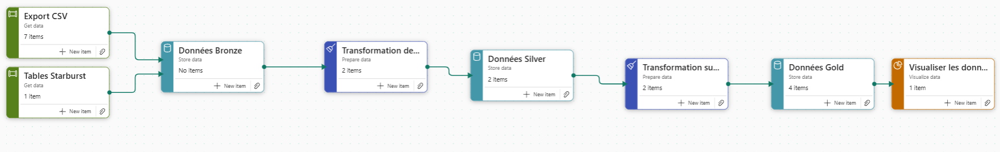

# Fabric Supervision Platform – End User

Cadre standardisé de supervision des usages **End User** dans Microsoft Fabric. La V1 couvre **Dataiku** sur les environnements DEV, INT, RPP et PROD, avec pour objectif de piloter finement les licences, suivre l'adoption et identifier les optimisations.



## Objectifs

- Piloter l'attribution des licences Dataiku (dotation vs utilisation réelle)
- Suivre l'adoption et l'intensité d'usage par équipe, projet et profil utilisateur
- Identifier les licences inactives, sous-utilisées ou les périmètres en tension
- Préparer l'extension du dispositif à Microsoft Fabric et Data Catalog

## Architecture

Le projet implémente une **architecture en médaillon** (Bronze → Silver → Gold) sur Microsoft Fabric :

```
Starburst (DEV/INT/RPP/PROD)
        │
        ▼  Dataflow Gen2 (Power Query M)
┌─────────────────────────────────────────┐
│  BRONZE  – snapshots bruts (Delta Lake) │
│  users, audit_logs, licences, projets…  │
└─────────────────────────────────────────┘
        │
        ▼  Notebooks Python/Polars
┌─────────────────────────────────────────┐
│  SILVER  – dimensions nettoyées         │
│  dim_utilisateur, dim_licence,          │
│  dim_instance, dim_project, dim_usage…  │
└─────────────────────────────────────────┘
        │
        ▼  Notebooks SQL/Spark (MERGE idempotent)
┌─────────────────────────────────────────┐
│  GOLD    – faits analytiques            │
│  fait_usage_dataiku_utilisateur         │
│  fait_licence_dataiku                   │
└─────────────────────────────────────────┘
        │
        ▼  DirectLake
┌─────────────────────────────────────────┐
│  SEMANTIC MODEL – mesures, relations    │
└─────────────────────────────────────────┘
        │
        ├──▶  Rapport Power BI
        └──▶  Data Agent IA
```

## Stack technique

| Composant | Technologie |
|-----------|-------------|
| Ingestion | Dataflow Gen2 |
| Stockage | Microsoft Fabric Lakehouse (Delta Lake) |
| Transformation | Notebooks Fabric (Python/Polars, SQL/Spark) |
| Orchestration | Data Pipelines Fabric |
| Configuration | Variable Library |
| Sémantique | Semantic Model Fabric / Power BI (DirectLake) |
| Reporting | Rapport Power BI (avec thème FDJ dark/light) |
| IA | Data Agent connecté au Semantic Model |
| Source | Starburst – instances Dataiku |

## Structure du dépôt

```
FabricSupervisionPlatform/
├── Dataflows/                          # Dataflow Gen2 – ingestion Starburst → Bronze
├── Data Pipelines/                     # Orchestration (Master + sous-pipelines)
├── Notebooks/                          # Transformations Bronze→Silver→Gold + utilitaires
├── Lakehouse_End_User_Platform.Lakehouse/  # Lakehouse Fabric (schemas bronze/silver/gold/tech)
├── Semantic Models/                    # Semantic Model DirectLake (TMDL)
├── Reports/                            # Rapport Power BI
├── Data Agents/                        # Agent IA (instructions + datasource)
├── VL_ENV_SupervisionPlatform.VariableLibrary/  # Variables de configuration
├── Images/                             # Diagrammes d'architecture
└── docs/                               # Documentation détaillée (→ voir ci-dessous)
```

## Documentation

| Document | Description |
|----------|-------------|
| [Architecture](docs/01-architecture.md) | Vue d'ensemble, flux de données, schémas |
| [Ingestion Bronze](docs/02-ingestion-bronze.md) | Dataflows Gen2, sources Starburst, chargement incrémental |
| [Transformation Silver](docs/03-transformation-silver.md) | Notebooks dimensions, règles métier, qualité |
| [Couche Gold](docs/04-gold-analytique.md) | Tables de faits, MERGE idempotent, indicateurs |
| [Semantic Model](docs/05-modele-semantique.md) | Relations, mesures DAX, mode DirectLake |
| [Rapport Power BI](docs/06-rapport-powerbi.md) | Pages, visuels, thème, bookmarks |
| [Data Agent IA](docs/07-data-agent.md) | Configuration, règles métier, exemples de questions |
| [Orchestration](docs/08-orchestration.md) | Pipelines, Variable Library, exécution incrémentale |
| [Gouvernance & Qualité](docs/09-gouvernance-qualite.md) | Sécurité, RGPD, contrôles qualité, traçabilité |

## Périmètre V1 / Roadmap

| Version | Périmètre | Statut |
|---------|-----------|--------|
| V1 | Dataiku (DEV, INT, RPP, PROD) | En production |
| V2 | Microsoft Fabric (workspaces, artefacts, capacités) | Planifié |
| V3 | Data Catalog (consultations, documentation) | Planifié |
